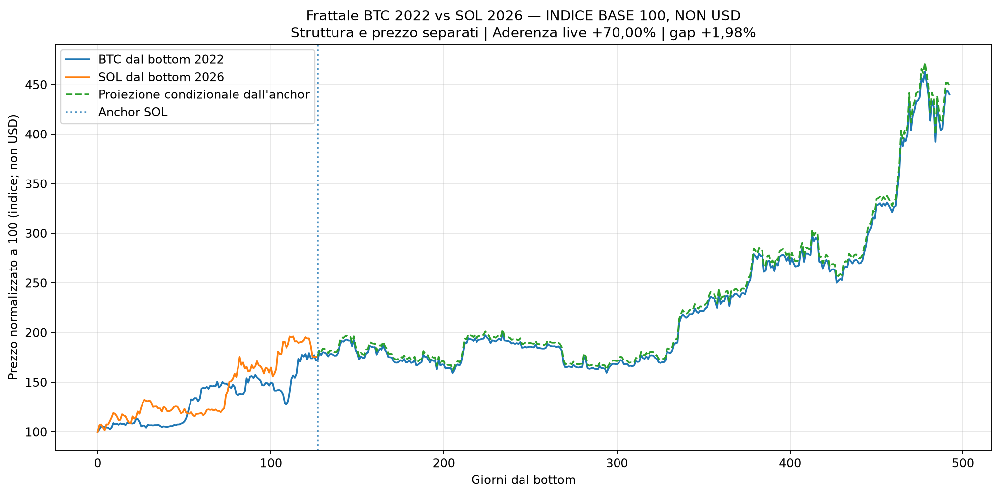
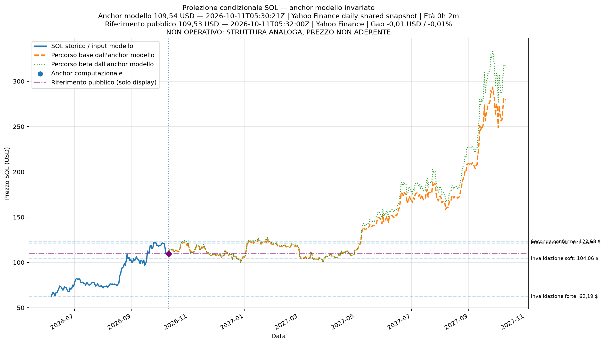
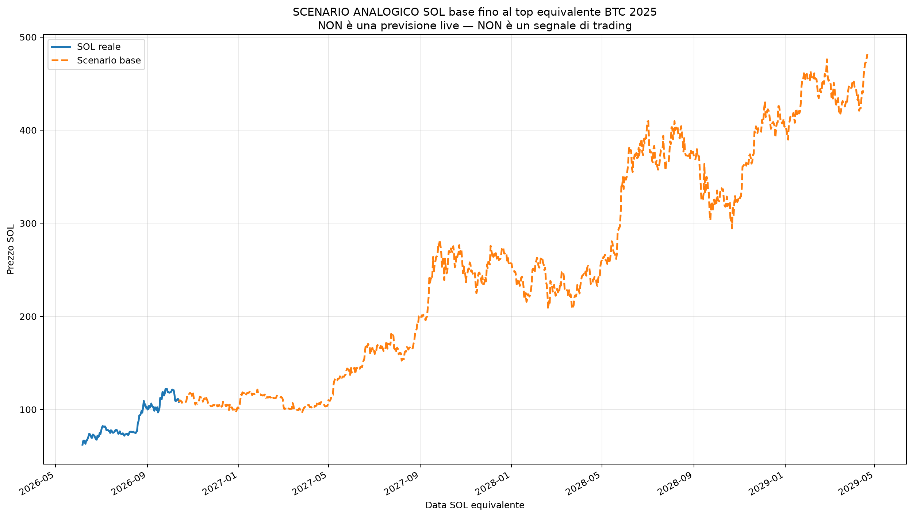
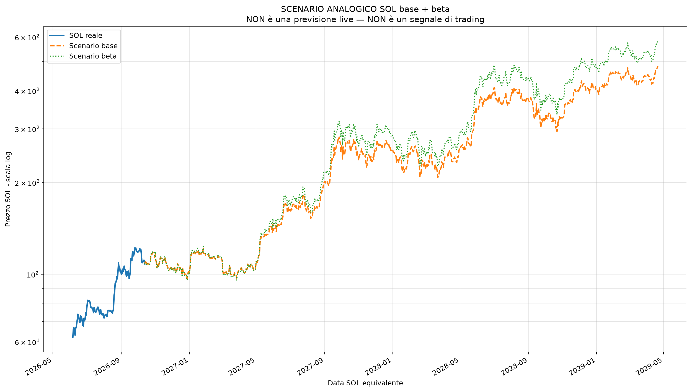
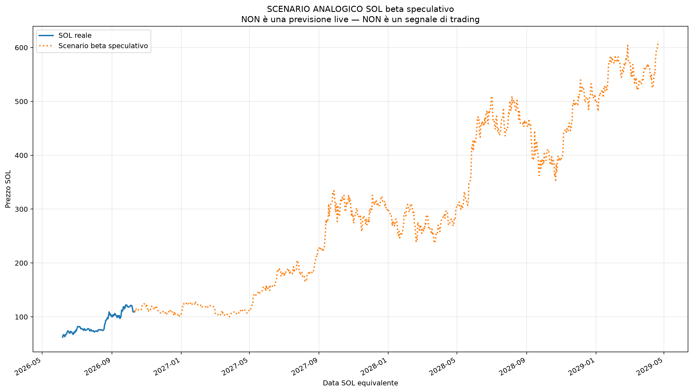
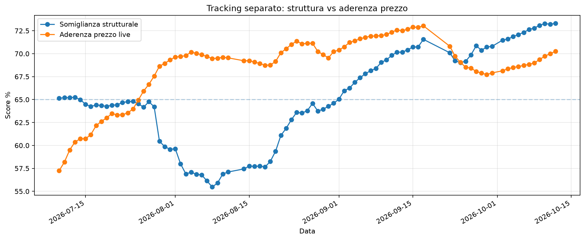

# Frattale mirato: BTC novembre 2022 vs SOL giugno 2026

Generato: **2026-10-12 07:32:46 CEST**
UTC: **2026-10-12 05:32:46 UTC**

Ultima candela SOL usata: **12 ottobre 2026**

## SOL PRICE CONTEXT

| Voce | Valore | Provenienza / significato |
| --- | --- | --- |
| Anchor computazionale | 112,60 $ | 2026-10-12T05:30:22Z \| Yahoo Finance daily shared snapshot \| Close 1d |
| Candela anchor completata | NO | Stato esplicito; il valore non viene sostituito dal prezzo pubblico. |
| Riferimento pubblico corrente | 112,38 $ | 2026-10-12T05:32:00Z \| Yahoo Finance \| solo display |
| Età anchor alla generazione | 0h 2m | WITHIN_DAILY_REPORT_CADENCE |
| Gap corrente vs anchor | -0,22000 $ | -0,20% |
| Validità input modello | REPRODUCIBLE_SHARED_SNAPSHOT | Non è una dichiarazione di validità del segnale/trading. |

```text
COMPUTATIONAL_ANCHOR_PRICE=112.5999984741211
COMPUTATIONAL_ANCHOR_FIELD=Close
COMPUTATIONAL_ANCHOR_TIMESTAMP=2026-10-12T05:30:22Z
COMPUTATIONAL_ANCHOR_SYMBOL=SOL-USD
COMPUTATIONAL_ANCHOR_PROVIDER=Yahoo Finance daily shared snapshot
COMPUTATIONAL_ANCHOR_TIMEFRAME=1d
COMPUTATIONAL_ANCHOR_COMPLETED=NO
CURRENT_PUBLIC_REFERENCE_PRICE=112.37999725341797
CURRENT_PUBLIC_REFERENCE_TIMESTAMP=2026-10-12T05:32:00Z
CURRENT_PUBLIC_REFERENCE_ACQUIRED_AT=2026-10-12T05:32:46Z
CURRENT_PUBLIC_REFERENCE_SYMBOL=SOL-USD
CURRENT_PUBLIC_REFERENCE_PROVIDER=Yahoo Finance
CURRENT_PUBLIC_REFERENCE_FIELD=Close
CURRENT_PUBLIC_REFERENCE_TIMEFRAME=1m
CURRENT_PUBLIC_REFERENCE_STATUS=AVAILABLE
ANCHOR_AGE_SECONDS=144.891823
ANCHOR_AGE_HOURS=0.04024772861111111
CURRENT_VS_ANCHOR_GAP_USD=-0.220001220703125
CURRENT_VS_ANCHOR_GAP_PCT=-0.1953829695243603
```

Correzione metodologica: questo report separa **somiglianza strutturale** e **aderenza reale del prezzo**.
Un 70% di forma simile non significa che il prezzo sia vicino al percorso BTC scalato.

## Verdetto diretto

**SOL sta seguendo BTC 2022?**

### ANALOGIA DEBOLE / SCENARIO SECONDARIO

**Sintesi:** Esistono alcuni elementi comuni, ma non abbastanza per una conferma.

**Somiglianza strutturale:** +73,30%

**Aderenza prezzo live:** +70,25%

**Errore medio live:** +14,87%

**Gap corrente:** +0,83%

**Fase attuale:** FRATTALE SOLO DI CONTESTO

**Lettura fase:** Il paragone non ha ancora forza operativa.

**Rischio fase:** ALTO

**Prossimo step:** Proiezione condizionale, non conferma operativa: **Leggera continuazione rialzista.** Zona bassa **110,38 $** intorno al **17 ottobre 2026**; zona alta **120,09 $** intorno al **25 ottobre 2026**; fine step circa **119,71 $** entro il **26 ottobre 2026**.

**Cosa fare:** Osserva soltanto; non usarlo per leva o decisioni principali.

**Affidabilità:** BASSA

### Perché

- Somiglianza strutturale +73,30%.
- Aderenza prezzo live +70,25%.
- Errore medio live +14,87%.
- Gap corrente SOL vs BTC scalato +0,83%.

### Livelli pratici

| Livello | Prezzo / soglia | Significato |
| --- | --- | --- |
| Rientro gap | entro ±12% | Condizione necessaria per tornare operativo. |
| Prima conferma prezzo | 120,09 $ | Rottura iniziale, da accompagnare al rientro del gap. |
| Seconda conferma | 126,11 $ | Scenario più credibile. |
| Invalidazione soft | 106,97 $ | Il setup si indebolisce. |
| Invalidazione forte | 62,19 $ | Il paragone è quasi rotto. |

Per tornare operativo non basta salire: il gap rispetto al BTC scalato deve rientrare circa entro ±12%. La prima conferma di prezzo è 120,09 $, mentre l'invalidazione soft è 106,97 $.

### Metadata aderenza prezzo

```text
OPERATIONAL_VERDICT_REASON=ANALOGIA DEBOLE / SCENARIO SECONDARIO
PRICE_ADHERENCE_FAILED=NO
PRICE_ADHERENCE_LIVE_AVG_GAP_FAILED=NO
PRICE_ADHERENCE_LAST_GAP_FAILED=NO
PRICE_ADHERENCE_LIVE_AVG_GAP_THRESHOLD_PCT=15.0
PRICE_ADHERENCE_LAST_GAP_THRESHOLD_PCT=18.0
PRICE_ADHERENCE_OBSERVED_LIVE_AVG_GAP_PCT=14.874640662292878
PRICE_ADHERENCE_OBSERVED_LAST_GAP_PCT=0.8317805184366422
```

## Somiglianza prima e dopo inizio programma

Questa sezione separa la somiglianza della forma dall'aderenza reale del prezzo.

- **Inizio programma/scanner:** 3 luglio 2026
- **Prima del programma** = backtest retroattivo.
- **Da inizio programma** = verifica live: è la parte più importante per l'uso operativo.

| Periodo | Date | Giorni | Aderenza prezzo | Errore medio | Gap ultimo | Stato |
| --- | --- | --- | --- | --- | --- | --- |
| Prima del programma | 6 giugno 2026 -> 2 luglio 2026 | 27 | +87,95% | +6,02% | +21,89% | ABBASTANZA ALLINEATO |
| Da inizio programma | 3 luglio 2026 -> 12 ottobre 2026 | 102 | +70,25% | +14,87% | +0,83% | DEVIAZIONE MODERATA |
| Totale dal bottom | 6 giugno 2026 -> 12 ottobre 2026 | 129 | +73,96% | +13,02% | +0,83% | DEVIAZIONE MODERATA |

Nota: un frattale può avere una forma simile ma un prezzo distante. In quel caso non è operativo finché il gap non rientra.

## Lettura operativa

Il frattale resta non operativo. Motivo effettivo: ANALOGIA DEBOLE / SCENARIO SECONDARIO.

| Voce | Risposta | Perché |
| --- | --- | --- |
| Uso operativo | NO | Peso 0 per il verdetto: ANALOGIA DEBOLE / SCENARIO SECONDARIO. |
| Aderenza live | +70,25% | Errore medio live +14,87%. |
| Gap corrente | +0,83% | Metrica separata dal motivo del verdetto. |
| Prima conferma prezzo | 120,09 $ | Serve anche miglioramento del gap, non solo una candela sopra il livello. |
| Seconda conferma | 126,11 $ | Rende più credibile il percorso, ma non sostituisce l'aderenza. |
| Invalidazione soft | 106,97 $ | Sotto questa zona il quadro peggiora. |
| Invalidazione forte | 62,19 $ | Sotto il bottom il paragone è quasi rotto. |

## Tracking giornaliero

**Stato struttura:** STRUTTURA STABILE

Variazione strutturale +0,09%.

| Data | Prezzo SOL | Struttura | Aderenza live | Gap | Verdetto |
| --- | --- | --- | --- | --- | --- |
| 2026-10-06 | 120,12 $ | +72,32% | +68,71% | +7,62% | STRUTTURA ANALOGA, PREZZO NON ADERENTE |
| 2026-10-07 | 118,59 $ | +72,63% | +68,84% | +9,50% | STRUTTURA ANALOGA, PREZZO NON ADERENTE |
| 2026-10-08 | 115,51 $ | +72,79% | +68,98% | +6,65% | STRUTTURA ANALOGA, PREZZO NON ADERENTE |
| 2026-10-09 | 110,49 $ | +73,09% | +69,36% | +0,19% | STRUTTURA ANALOGA, PREZZO NON ADERENTE |
| 2026-10-10 | 109,96 $ | +73,29% | +69,73% | +2,85% | STRUTTURA ANALOGA, PREZZO NON ADERENTE |
| 2026-10-11 | 109,54 $ | +73,21% | +70,00% | +1,98% | STRUTTURA ANALOGA, PREZZO NON ADERENTE |
| 2026-10-12 | 112,60 $ | +73,30% | +70,25% | +0,83% | ANALOGIA DEBOLE / SCENARIO SECONDARIO |

## Grafici

### Frattale sovrapposto

**Scala:** indice normalizzato, base 100. I valori non sono prezzi USD.



### Proiezione condizionale SOL

Blu e proiezioni usano l'anchor computazionale; l'eventuale riferimento pubblico è un marker separato, solo display.



### Ciclo base fino al top BTC 2025

**Scenario analogico in USD: non è una previsione live e non è un segnale di trading.**



### Base + beta in scala logaritmica



### Beta speculativo separato



### Tracking struttura vs aderenza




## Proiezione fino al top BTC 2025

| Voce | Valore | Lettura |
| --- | --- | --- |
| Stato | CONTESTO MACRO, NON OPERATIVO | Non è un segnale d'ingresso. |
| Top BTC 2025 usato | 6 ottobre 2025 - 124.753 $ | Massimo close BTC nella finestra 2025. |
| Data SOL equivalente | 21 aprile 2029 | Data analogica, non previsione certa. |
| Target base dal bottom | 491,43 $ | Scenario base. |
| Target base dall'anchor modello | 495,52 $ | Scenario condizionale dall'input computazionale, non dal riferimento live. |
| Massimo percorso base | 495,52 $ (21 aprile 2029) | Massimo base nel percorso. |
| Massimo beta | 596,29 $ (21 aprile 2029) | Scenario speculativo, non target principale. |

## Prossimi step condizionali

| Step | Date SOL | BTC fine | SOL fine base | Zona bassa | Zona alta | Lettura |
| --- | --- | --- | --- | --- | --- | --- |
| Step 1 - prossime 2 settimane | 12 ottobre 2026 -> 26 ottobre 2026 | +6,32% | 119,71 $ | 110,38 $ (17 ottobre 2026) | 120,09 $ (25 ottobre 2026) | Leggera continuazione rialzista. |
| Step 2 - primo mese | 27 ottobre 2026 -> 11 novembre 2026 | +3,50% | 116,54 $ | 108,34 $ (4 novembre 2026) | 121,09 $ (28 ottobre 2026) | Prima spike, poi scarico. |
| Step 3 - secondo mese | 12 novembre 2026 -> 11 dicembre 2026 | -0,93% | 111,56 $ | 104,60 $ (7 dicembre 2026) | 117,31 $ (18 novembre 2026) | Prima spike, poi scarico. |
| Step 4 - terzo mese | 12 dicembre 2026 -> 10 gennaio 2027 | +8,25% | 121,89 $ | 99,80 $ (28 dicembre 2026) | 121,92 $ (6 gennaio 2027) | Prima retest / debolezza, poi recupero. |
| Step 5 - quarto mese | 11 gennaio 2027 -> 9 febbraio 2027 | +3,04% | 116,02 $ | 115,89 $ (6 febbraio 2027) | 125,02 $ (26 gennaio 2027) | Laterale / movimento non forte. |
| Step 6 - estensione 6 mesi | 10 febbraio 2027 -> 10 aprile 2027 | -7,23% | 104,46 $ | 99,95 $ (27 marzo 2027) | 118,23 $ (21 febbraio 2027) | Prima spike, poi scarico. |

## Proiezione standard a giorni fissi

Queste proiezioni partono dall'anchor computazionale SOL e replicano i movimenti futuri del BTC equivalente. Il riferimento pubblico corrente è solo contesto e non modifica i percorsi.

| Orizzonte | Data SOL | Data BTC eq. | BTC fece | SOL base | SOL beta | Min percorso | Max percorso |
| --- | --- | --- | --- | --- | --- | --- | --- |
| 7 giorni | 19 ottobre 2026 | 2023-04-05 | -0,60% | 111,92 $ | 111,84 $ | 110,38 $ | 113,12 $ |
| 14 giorni | 26 ottobre 2026 | 2023-04-12 | +6,32% | 119,71 $ | 120,63 $ | 110,38 $ | 120,09 $ |
| 30 giorni | 11 novembre 2026 | 2023-04-28 | +3,50% | 116,54 $ | 117,04 $ | 108,34 $ | 121,09 $ |
| 60 giorni | 11 dicembre 2026 | 2023-05-28 | -0,93% | 111,56 $ | 111,43 $ | 104,60 $ | 121,09 $ |
| 90 giorni | 10 gennaio 2027 | 2023-06-27 | +8,25% | 121,89 $ | 123,11 $ | 99,80 $ | 121,92 $ |
| 120 giorni | 9 febbraio 2027 | 2023-07-27 | +3,04% | 116,02 $ | 116,46 $ | 99,80 $ | 125,02 $ |
| 180 giorni | 10 aprile 2027 | 2023-09-25 | -7,23% | 104,46 $ | 103,48 $ | 99,80 $ | 125,02 $ |
| 365 giorni | 12 ottobre 2027 | 2024-03-28 | +149,56% | 281,00 $ | 315,01 $ | 99,80 $ | 290,29 $ |

## Dati base

| Voce | Data | Valore |
| --- | --- | --- |
| BTC bottom usato | 2022-11-21 | 15.787 $ |
| SOL bottom usato | 2026-06-06 | 62,19 $ |
| Anchor computazionale SOL | 12 ottobre 2026 | 112,60 $ |
| Giorni SOL dal bottom | - | 128 |
| Data BTC equivalente | 2023-03-29 | - |
| BTC normalizzato equivalente | - | 179,57 |
| SOL normalizzato oggi | - | 181,06 |
| Gap SOL vs BTC equivalente | - | +0,83% |
| Lettura gap | - | SOL è abbastanza vicino al percorso BTC equivalente. |
| Somiglianza forma prezzo | - | +88,10% |
| Somiglianza ritmo/rendimenti | - | +40,92% |
| Somiglianza RSI | - | +70,60% |
| Somiglianza medie | - | +69,42% |
| Somiglianza strutturale | - | +73,30% |
| Beta volatilità SOL/BTC | - | 1,12 |

## Regola di lettura

- **Struttura alta + aderenza alta** = frattale utile.
- **Struttura alta + aderenza bassa** = forma simile, ma non conferma operativa.
- **Gap oltre ±15/18%** = il prezzo è troppo staccato per assegnare punti al Global.
- **Rientro del gap entro circa ±12%** = primo requisito per rivalutare il frattale.
