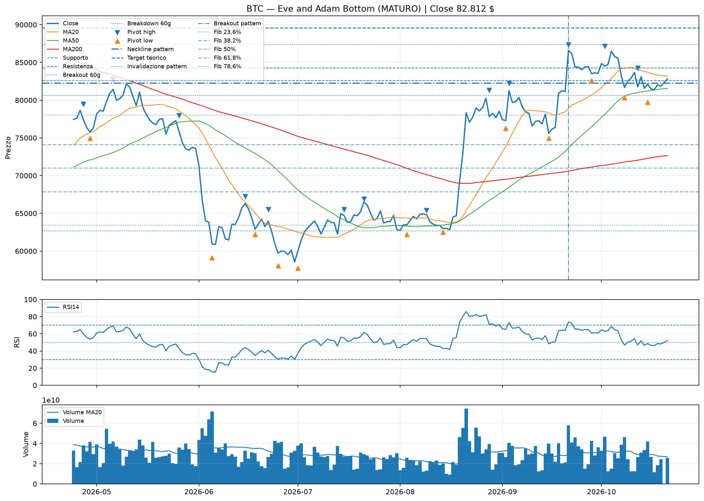
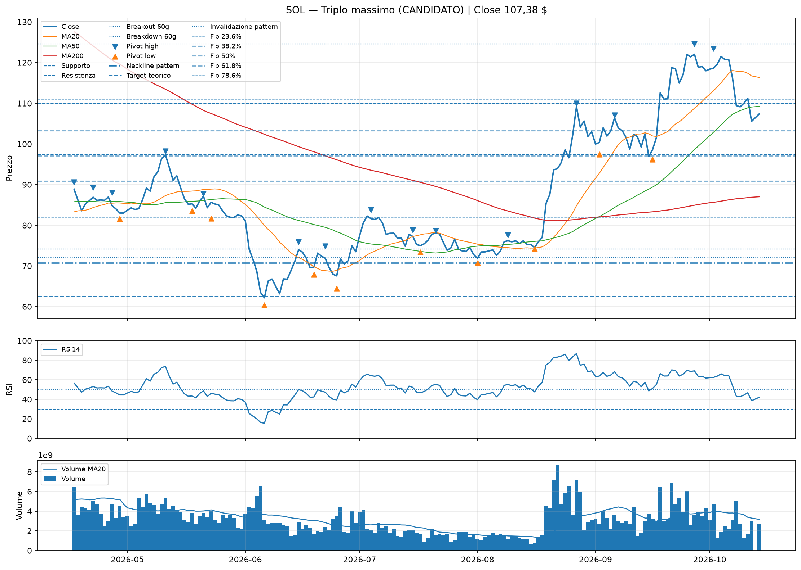
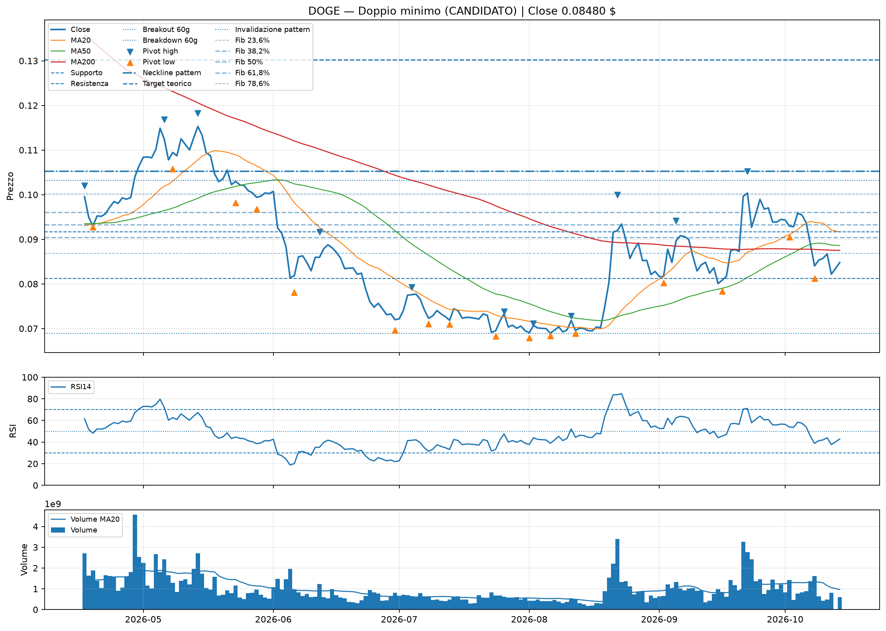

# Classic technical visual report

Generato: 2026-10-27 06:33 UTC

Questo report crea grafici visivi dei pattern tecnici principali. Serve per vedere il grafico e il ciclo di vita dei pattern; non aggiunge automaticamente punteggio al Global.

Regola anti-pattern-zombie: dopo il breakout un pattern passa da ATTIVO a CONFERMATO RECENTE, poi a MATURO. Quando raggiunge il target o viene invalidato vale 0 e non resta confermato per sempre.

Pattern controllati:

- doppio minimo
- doppio massimo
- testa e spalle
- testa e spalle inverso
- triangolo / compressione
- candela giornaliera principale
- pivot high / pivot low
- supporto, resistenza, breakout e breakdown 60 giorni
- data breakout, età, target teorico, progresso e invalidazione
- livelli Fibonacci 23,6 / 38,2 / 50 / 61,8 / 78,6 letti dal Technical Structure

## Sintesi visiva

| Asset | Prezzo | Pattern principale | Stato | Famiglia | Breakout | Target | Progresso | Distanza neckline | Fibonacci | Stato prezzo | Supporto |
| --- | --- | --- | --- | --- | --- | --- | --- | --- | --- | --- | --- |
| BTC | 79.617 $ | Doppio massimo | CANDIDATO | ribassista | n/a | 65.049 $ | n/a | 6,23% | Fib 23,6% TENUTO (0) @ 78.446 $ | NEL RANGE | 76.248 $ |
| SOL | 99,68 $ | Doppio massimo | CANDIDATO | ribassista | n/a | 82,41 $ | n/a | 3,59% | Fib 23,6% TENUTO (+1) @ 98,50 $ | NEL RANGE | 97,45 $ |
| DOGE | 0.07724 $ | Adam and Eve Top | CONFERMATO RECENTE | ribassista | 2026-10-17 | 0.06059 $ | 15,45% | n/a | Fib 23,6% NON ATTIVO (0) @ 0.08308 $ | NEL RANGE | 0.07623 $ |

## BTC

- Pattern principale: **Doppio massimo**
- Stato pattern: **CANDIDATO** (0)
- Famiglia: **ribassista**
- Confidenza lifecycle: **TECHNICAL STRUCTURE**
- Formazione: **2026-09-03 -> 2026-10-21**
- Età formazione: **6 giorni**
- Breakout pattern: **n/a**
- Età breakout: **n/a**
- Neckline: **74.945 $**
- Target teorico: **65.049 $**
- Progresso verso target: **n/a**
- Distanza dalla neckline: **6,23%**
- Fonte lifecycle: **technical_structure_metrics.csv**
- Fibonacci: **Fib 23,6% TENUTO (0) @ 78.446 $** — Swing UP 2026-07-01 57.748 -> 2026-10-21 84.840; livello più vicino 23.6% a 78.446; stato TENUTO; confluenza: nessuna confluenza indipendente.
- Invalidazione: **76.443 $**
- Relazione prezzo/neckline: **sopra neckline**
- Dettaglio: Due massimi simili vicino a 84.840 tra 2026-09-03 e 2026-10-21. Neckline ribassista stimata: 74.945. Stato: CANDIDATO; la neckline non è ancora stata rotta con un margine di almeno 0.50%. Età della formazione: 6 giorni. Fonte lifecycle: technical_structure_metrics.csv.
- Candela più recente: **Nessuna candela forte**
- Stato prezzo: **NEL RANGE**
- Supporto: **76.248 $**
- Resistenza: **81.347 $**
- Breakout 60g: **87.364 $**
- Breakdown 60g: **74.945 $**
- RSI14: **40.16**
- ATR14: **2,50%**
- Volume ratio 20g: **1.00**
- Rendimento 30g: **-5,67%**
- Rendimento 90g: **+24,65%**

### Pattern trovati

| Pattern | Stato | Score | Famiglia | Neckline | Breakout | Età | Target | Progresso | Distanza neckline | Invalidazione | Dettaglio |
| --- | --- | --- | --- | --- | --- | --- | --- | --- | --- | --- | --- |
| Doppio massimo | CANDIDATO | 0 | ribassista | 74.945 $ | n/a | n/a | 65.049 $ | n/a | 6,23% | 76.443 $ | Due massimi simili vicino a 84.840 tra 2026-09-03 e 2026-10-21. Neckline ribassista stimata: 74.945. Stato: CANDIDATO; la neckline non è ancora stata rotta con un margine di almeno 0.50%. Età della formazione: 6 giorni. Fonte lifecycle: technical_structure_metrics.csv. |
| Doppio massimo | ATTIVO | -1 | ribassista | 80.337 $ | 2026-10-27 | 0g | 73.527 $ | 10,58% | n/a | 81.944 $ | Due massimi simili a 87.146 $ e 84.249 $. Neckline circa 80.337 $. Breakout neckline: 2026-10-27 (0 giorni fa). Stato: ATTIVO. Target teorico: 73.527 $; progresso: 10,58%; prezzo vicino alla neckline. |
| Doppio minimo | CANDIDATO | 0 | rialzista | 87.146 $ | n/a | n/a | 94.557 $ | n/a | 9,46% | 85.403 $ | Due minimi simili a 82.571 $ e 79.736 $. Neckline circa 87.146 $. Stato: CANDIDATO; la neckline non è ancora stata rotta con un margine di almeno 0.50%. Età formazione: 12 giorni. |

## SOL

- Pattern principale: **Doppio massimo**
- Stato pattern: **CANDIDATO** (0)
- Famiglia: **ribassista**
- Confidenza lifecycle: **TECHNICAL STRUCTURE**
- Formazione: **2026-08-27 -> 2026-10-21**
- Età formazione: **6 giorni**
- Breakout pattern: **n/a**
- Età breakout: **n/a**
- Neckline: **96,23 $**
- Target teorico: **82,41 $**
- Progresso verso target: **n/a**
- Distanza dalla neckline: **3,59%**
- Fonte lifecycle: **technical_structure_metrics.csv**
- Fibonacci: **Fib 23,6% TENUTO (+1) @ 98,50 $** — Swing UP 2026-06-25 64,42 -> 2026-10-21 109,03; livello più vicino 23.6% a 98,50; stato TENUTO; confluenza: supporto tecnico, neckline ribassista, invalidazione ribassista.
- Invalidazione: **98,15 $**
- Relazione prezzo/neckline: **sopra neckline**
- Dettaglio: Due massimi simili vicino a 110,04 tra 2026-08-27 e 2026-10-21. Neckline ribassista stimata: 96,23. Stato: CANDIDATO; la neckline non è ancora stata rotta con un margine di almeno 0.50%. Età della formazione: 6 giorni. Fonte lifecycle: technical_structure_metrics.csv.
- Candela più recente: **Nessuna candela forte**
- Stato prezzo: **NEL RANGE**
- Supporto: **97,45 $**
- Resistenza: **107,12 $**
- Breakout 60g: **124,62 $**
- Breakdown 60g: **91,82 $**
- RSI14: **33.41**
- ATR14: **3,85%**
- Volume ratio 20g: **0.88**
- Rendimento 30g: **-17,91%**
- Rendimento 90g: **+35,25%**

### Pattern trovati

| Pattern | Stato | Score | Famiglia | Neckline | Breakout | Età | Target | Progresso | Distanza neckline | Invalidazione | Dettaglio |
| --- | --- | --- | --- | --- | --- | --- | --- | --- | --- | --- | --- |
| Doppio massimo | CANDIDATO | 0 | ribassista | 96,23 $ | n/a | n/a | 82,41 $ | n/a | 3,59% | 98,15 $ | Due massimi simili a 110,04 $ e 109,03 $. Neckline circa 96,23 $. Stato: CANDIDATO; la neckline non è ancora stata rotta con un margine di almeno 0.50%. Età formazione: 6 giorni. |
| Triangolo discendente possibile | CANDIDATO | 0 | ribassista | n/a | n/a | n/a | n/a | n/a | n/a | n/a | Massimi decrescenti e supporto quasi piatto. Stato: CANDIDATO; il pattern non ha una neckline univoca da usare per il lifecycle. |
| Doppio minimo | CANDIDATO | 0 | rialzista | 124,62 $ | n/a | n/a | 151,78 $ | n/a | 25,02% | 122,13 $ | Due minimi simili a 97,45 $ e 100,51 $. Neckline circa 124,62 $. Stato: CANDIDATO; la neckline non è ancora stata rotta con un margine di almeno 0.50%. Età formazione: 9 giorni. |
| Testa e spalle inverso | TARGET RAGGIUNTO | 0 | rialzista | 78,17 $ | 2026-08-19 | 69g | 85,65 $ | 287,65% | n/a | 76,61 $ | Spalla sinistra 73,40 $, testa 70,69 $, spalla destra 74,20 $. Neckline circa 78,17 $. Breakout neckline: 2026-08-19 (69 giorni fa). Stato: TARGET RAGGIUNTO. Target teorico: 85,65 $; progresso: 287,65%; prezzo sopra neckline. |

## DOGE

- Pattern principale: **Adam and Eve Top**
- Stato pattern: **CONFERMATO RECENTE** (-2)
- Famiglia: **ribassista**
- Confidenza lifecycle: **TECHNICAL STRUCTURE**
- Formazione: **2026-08-22 -> 2026-09-05**
- Età formazione: **52 giorni**
- Breakout pattern: **2026-10-17**
- Età breakout: **10 giorni**
- Neckline: **0.08028 $**
- Target teorico: **0.06059 $**
- Progresso verso target: **15,45%**
- Distanza dalla neckline: **n/a**
- Fonte lifecycle: **technical_structure_metrics.csv**
- Fibonacci: **Fib 23,6% NON ATTIVO (0) @ 0.08308 $** — Swing DOWN 2026-09-22 0.10528 -> 2026-10-18 0.07623; livello più vicino 23.6% a 0.08308; stato NON ATTIVO; confluenza: resistenza tecnica, invalidazione ribassista.
- Invalidazione: **0.08189 $**
- Relazione prezzo/neckline: **sotto neckline**
- Dettaglio: Pattern Adam and Eve Top vicino a 0.09998 dal 2026-08-22 al 2026-09-05. Un massimo è più appuntito e l'altro più arrotondato. Neckline ribassista stimata: 0.08028. Breakout neckline: 2026-10-17 (10 giorni fa). Stato: CONFERMATO RECENTE. Target teorico: 0.06059; progresso corrente: 15,45%. Relazione prezzo/neckline: sotto neckline. Fonte lifecycle: technical_structure_metrics.csv.
- Candela più recente: **Nessuna candela forte**
- Stato prezzo: **NEL RANGE**
- Supporto: **0.07623 $**
- Resistenza: **0.07923 $**
- Breakout 60g: **0.10528 $**
- Breakdown 60g: **0.07623 $**
- RSI14: **34.83**
- ATR14: **4,00%**
- Volume ratio 20g: **0.66**
- Rendimento 30g: **-20,18%**
- Rendimento 90g: **+9,17%**

### Pattern trovati

| Pattern | Stato | Score | Famiglia | Neckline | Breakout | Età | Target | Progresso | Distanza neckline | Invalidazione | Dettaglio |
| --- | --- | --- | --- | --- | --- | --- | --- | --- | --- | --- | --- |
| Adam and Eve Top | CONFERMATO RECENTE | -2 | ribassista | 0.08028 $ | 2026-10-17 | 10g | 0.06059 $ | 15,45% | n/a | 0.08189 $ | Pattern Adam and Eve Top vicino a 0.09998 dal 2026-08-22 al 2026-09-05. Un massimo è più appuntito e l'altro più arrotondato. Neckline ribassista stimata: 0.08028. Breakout neckline: 2026-10-17 (10 giorni fa). Stato: CONFERMATO RECENTE. Target teorico: 0.06059; progresso corrente: 15,45%. Relazione prezzo/neckline: sotto neckline. Fonte lifecycle: technical_structure_metrics.csv. |
| Doppio massimo | CONFERMATO RECENTE | -2 | ribassista | 0.08028 $ | 2026-10-17 | 10g | 0.06059 $ | 15,45% | n/a | 0.08189 $ | Due massimi simili a 0.09998 $ e 0.09421 $. Neckline circa 0.08028 $. Breakout neckline: 2026-10-17 (10 giorni fa). Stato: CONFERMATO RECENTE. Target teorico: 0.06059 $; progresso: 15,45%; prezzo sotto neckline. |
| Testa e spalle | ATTIVO | -1 | ribassista | 0.07732 $ | 2026-10-25 | 2g | 0.04935 $ | 0,27% | n/a | 0.07886 $ | Spalla sinistra 0.09421 $, testa 0.10528 $, spalla destra 0.08365 $. Neckline circa 0.07732 $. Breakout neckline: 2026-10-25 (2 giorni fa). Stato: ATTIVO. Target teorico: 0.04935 $; progresso: 0,27%; prezzo vicino alla neckline. |
| Doppio minimo | CANDIDATO | 0 | rialzista | 0.10528 $ | n/a | n/a | 0.13434 $ | n/a | 36,30% | 0.10318 $ | Due minimi simili a 0.07841 $ e 0.07623 $. Neckline circa 0.10528 $. Stato: CANDIDATO; la neckline non è ancora stata rotta con un margine di almeno 0.50%. Età formazione: 9 giorni. |

## Stati del ciclo di vita

- **CANDIDATO**: geometria presente, ma neckline non ancora rotta; score 0.
- **ATTIVO**: breakout avvenuto da 0 a 3 giorni; score prudente ±1.
- **CONFERMATO RECENTE**: breakout da 4 a 14 giorni; score ±2.
- **MATURO**: breakout più vecchio di 14 giorni e ancora valido; score ridotto ±1.
- **TARGET RAGGIUNTO**: movimento teorico già completato; score 0.
- **INVALIDATO**: due chiusure consecutive oltre la soglia opposta; score 0.

## Come leggerlo

- Il grafico in alto mostra prezzo, MA20, MA50, MA200, supporti, resistenze, neckline, target, invalidazione e livelli Fibonacci.
- Il pannello centrale mostra RSI14.
- Il pannello basso mostra volume e media volume 20 giorni.
- Un pattern CANDIDATO non è un segnale operativo: il progresso target resta n/a e viene mostrata soltanto la distanza dalla neckline.
- TARGET RAGGIUNTO e INVALIDATO restano visibili per memoria storica, ma valgono 0.
- Il pattern principale usa come fonte autorevole il lifecycle di technical_structure_metrics.csv; il detector visuale resta di supporto grafico.
- Fibonacci non crea un segnale autonomo: pesa al massimo ±1 nel Technical Structure solo con una confluenza indipendente.

Nota: questi pattern sono riconosciuti con regole algoritmiche semplici. Sono utili per visualizzare il grafico, ma vanno sempre controllati a occhio.
