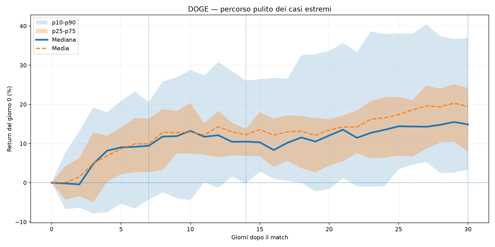
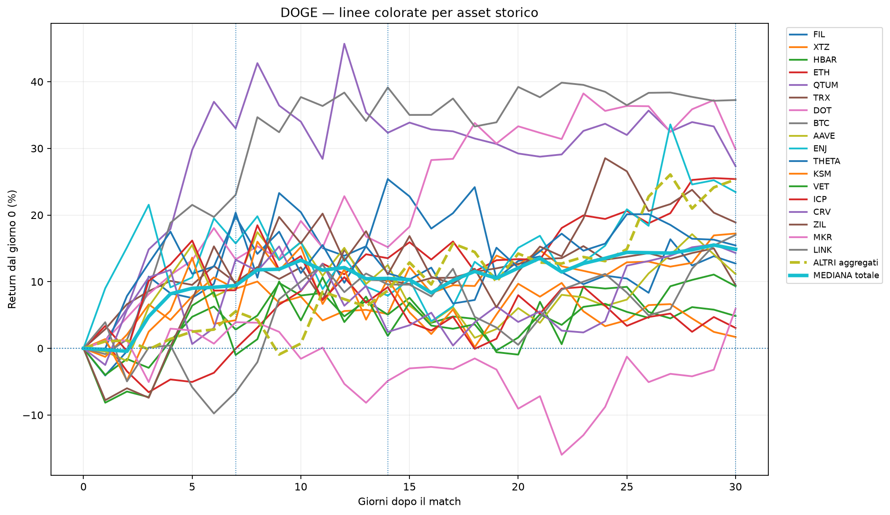
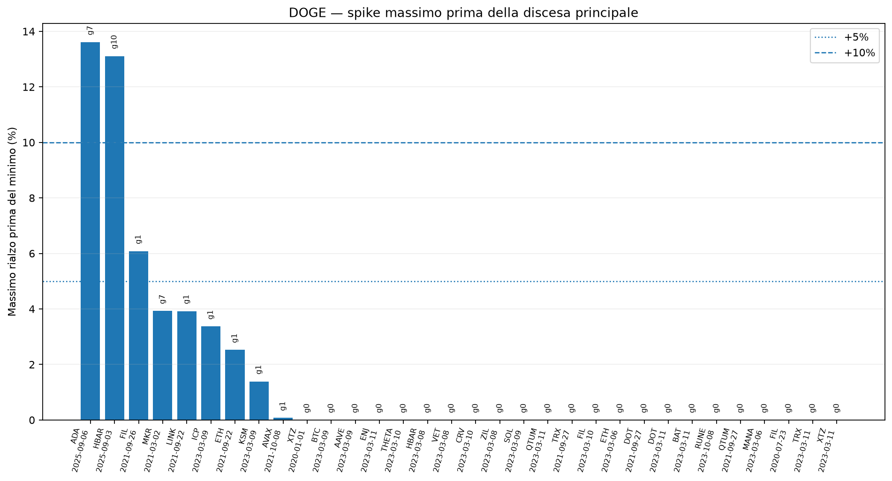
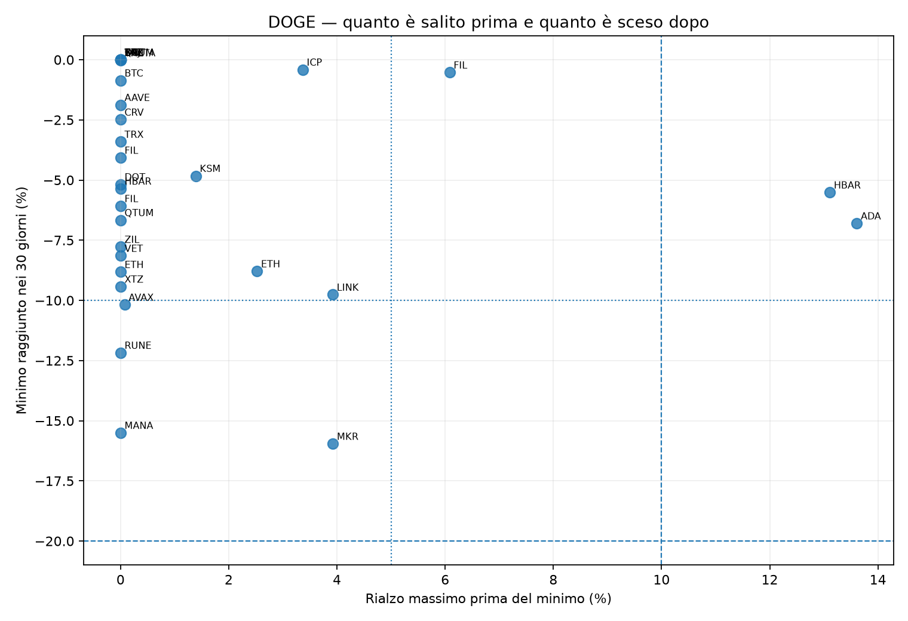
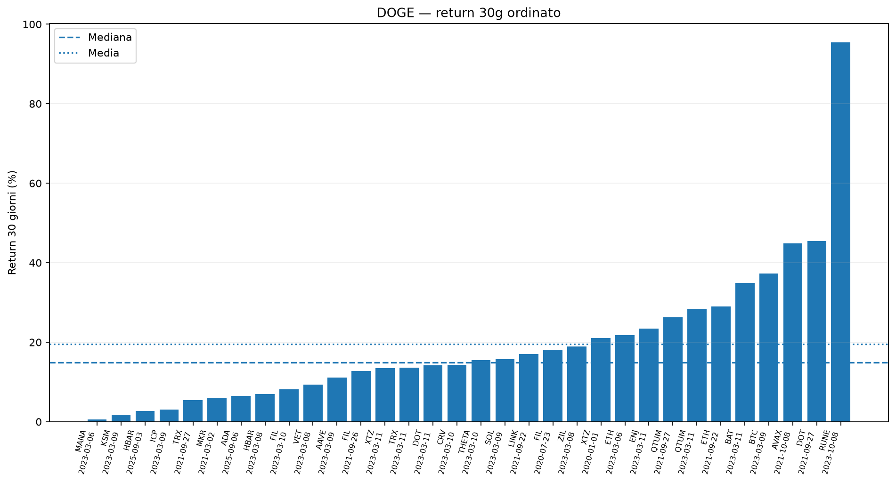

# Extreme cases path report

Generato: 2026-10-13 05:32 UTC

Questo report si attiva quando i casi positivi o negativi sono almeno **80%**.

Ora misura anche il **rialzo massimo prima della discesa principale**, quindi distingue uno spike iniziale da una discesa quasi immediata.

## Trigger estremi

| Asset   | Direzione            | Trigger   | Percentuale   | Motivo                           |   Match disponibili |
|:--------|:---------------------|:----------|:--------------|:---------------------------------|--------------------:|
| BTC     | NESSUNO              | NO        | +55,00%       | Nessun lato sopra soglia estrema |                  40 |
| SOL     | NESSUNO              | NO        | +70,00%       | Nessun lato sopra soglia estrema |                  40 |
| DOGE    | POSITIVO / RIALZISTA | SI        | +80,00%       | Casi positivi 80.00% >= 80%      |                  40 |

## DOGE — casi rialzisti

- Trigger: **Casi positivi 80.00% >= 80%**
- Casi usati nei grafici: **32**
- Return mediano 7g: **+9,43%**
- Return mediano 14g: **+10,49%**
- Return mediano 30g: **+14,87%**
- Drawdown mediano: **-5,00%**
- Max gain mediano: **+22,13%**

### Quanto salivano prima di scendere

- Spike massimo mediano prima del minimo: **+0,00%**
- Spike massimo medio prima del minimo: **+1,50%**
- Spike p75 prima del minimo: **+0,40%**
- Giorno mediano dello spike: **giorno 0**
- Giorno mediano del minimo: **giorno 1**
- Scarico mediano dal picco al minimo: **-5,72%**
- Casi con almeno +5% prima del minimo: **+9,38%**
- Casi con almeno +10% prima del minimo: **+6,25%**
- Casi con almeno +15% prima del minimo: **+0,00%**
- Discesa quasi immediata: **+75,00%**

Un segnale ribassista a 30 giorni non significa necessariamente discesa immediata: alcuni casi fanno prima uno spike e poi scaricano.

### Distribuzione 30 giorni

| P10    | P25    | P50     | P75     | P90     |
|:-------|:-------|:--------|:--------|:--------|
| +3,30% | +7,89% | +14,87% | +24,14% | +37,01% |

### Grafico pulito: bande + mediana

### Grafico asset per asset

### Spike massimo prima della discesa

La sigla `g7` sopra una barra significa che il massimo rialzo è avvenuto al giorno 7.

### Spike iniziale contro minimo successivo

### Casi ordinati per risultato finale

### Casi con spike maggiore prima del dump

| Asset storico   | End        | Similarity   | Spike prima del minimo   |   Giorno spike | Minimo 30g   |   Giorno minimo | Dump dal picco   | Return 30g   | Sequenza                      |
|:----------------|:-----------|:-------------|:-------------------------|---------------:|:-------------|----------------:|:-----------------|:-------------|:------------------------------|
| ADA-USD         | 2025-09-06 | +83,23%      | +13,61%                  |              7 | -6,80%       |              19 | -17,97%          | +6,52%       | ECCEZIONE POSITIVA            |
| HBAR-USD        | 2025-09-03 | +82,96%      | +13,11%                  |             10 | -5,52%       |              22 | -16,47%          | +2,72%       | ECCEZIONE POSITIVA            |
| FIL-USD         | 2021-09-26 | +84,92%      | +6,08%                   |              1 | -0,53%       |               2 | -6,23%           | +12,73%      | ECCEZIONE POSITIVA            |
| MKR-USD         | 2021-03-02 | +84,20%      | +3,93%                   |              7 | -15,96%      |              22 | -19,13%          | +5,95%       | RIALZO MODESTO PRIMA DEL DUMP |
| LINK-USD        | 2021-09-22 | +83,87%      | +3,92%                   |              1 | -9,76%       |               6 | -13,17%          | +17,02%      | ECCEZIONE POSITIVA            |
| ICP-USD         | 2023-03-09 | +85,01%      | +3,37%                   |              1 | -0,41%       |               2 | -3,66%           | +3,07%       | ECCEZIONE POSITIVA            |
| ETH-USD         | 2021-09-22 | +84,93%      | +2,52%                   |              1 | -8,79%       |               6 | -11,04%          | +28,99%      | ECCEZIONE POSITIVA            |
| KSM-USD         | 2023-03-09 | +85,19%      | +1,39%                   |              1 | -4,83%       |               2 | -6,13%           | +1,71%       | DISCESA QUASI IMMEDIATA       |
| AVAX-USD        | 2021-10-08 | +83,40%      | +0,08%                   |              1 | -10,18%      |               4 | -10,25%          | +44,92%      | DISCESA QUASI IMMEDIATA       |
| XTZ-USD         | 2020-01-01 | +88,49%      | +0,00%                   |              0 | -9,43%       |               1 | -9,43%           | +21,02%      | DISCESA QUASI IMMEDIATA       |
| BTC-USD         | 2023-03-09 | +87,25%      | +0,00%                   |              0 | -0,86%       |               1 | -0,86%           | +37,25%      | DISCESA QUASI IMMEDIATA       |
| AAVE-USD        | 2023-03-09 | +85,59%      | +0,00%                   |              0 | -1,88%       |               2 | -1,88%           | +11,15%      | DISCESA QUASI IMMEDIATA       |
| ENJ-USD         | 2023-03-11 | +85,54%      | +0,00%                   |              0 | +0,00%       |               0 | +0,00%           | +23,45%      | DISCESA QUASI IMMEDIATA       |
| THETA-USD       | 2023-03-10 | +85,26%      | +0,00%                   |              0 | -0,02%       |               1 | -0,02%           | +15,44%      | DISCESA QUASI IMMEDIATA       |
| HBAR-USD        | 2023-03-08 | +85,16%      | +0,00%                   |              0 | -5,35%       |               1 | -5,35%           | +6,98%       | DISCESA QUASI IMMEDIATA       |
| VET-USD         | 2023-03-08 | +85,08%      | +0,00%                   |              0 | -8,15%       |               1 | -8,15%           | +9,33%       | DISCESA QUASI IMMEDIATA       |
| CRV-USD         | 2023-03-10 | +84,43%      | +0,00%                   |              0 | -2,49%       |               1 | -2,49%           | +14,31%      | DISCESA QUASI IMMEDIATA       |
| ZIL-USD         | 2023-03-08 | +84,26%      | +0,00%                   |              0 | -7,77%       |               1 | -7,77%           | +18,89%      | DISCESA QUASI IMMEDIATA       |
| SOL-USD         | 2023-03-09 | +83,28%      | +0,00%                   |              0 | +0,00%       |               0 | +0,00%           | +15,76%      | DISCESA QUASI IMMEDIATA       |
| QTUM-USD        | 2023-03-11 | +83,10%      | +0,00%                   |              0 | +0,00%       |               0 | +0,00%           | +28,44%      | DISCESA QUASI IMMEDIATA       |

## Come leggerlo

- **Grafico pulito**: mostra il percorso centrale.
- **Asset per asset**: mostra le differenze tra gli analoghi storici.
- **Spike prima della discesa**: risponde a quanto poteva salire prima di scendere.
- **Spike contro minimo**: mostra quanto rialzo iniziale è stato poi seguito da quale discesa.

Questo report è diagnostico e non modifica il Global Confluence.
