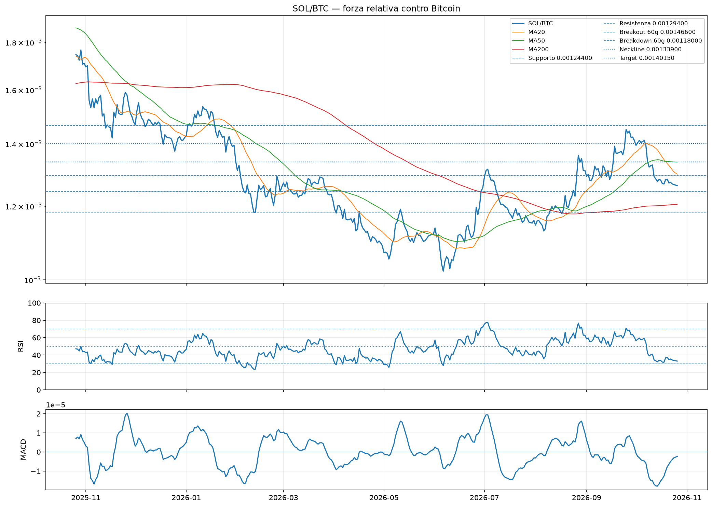
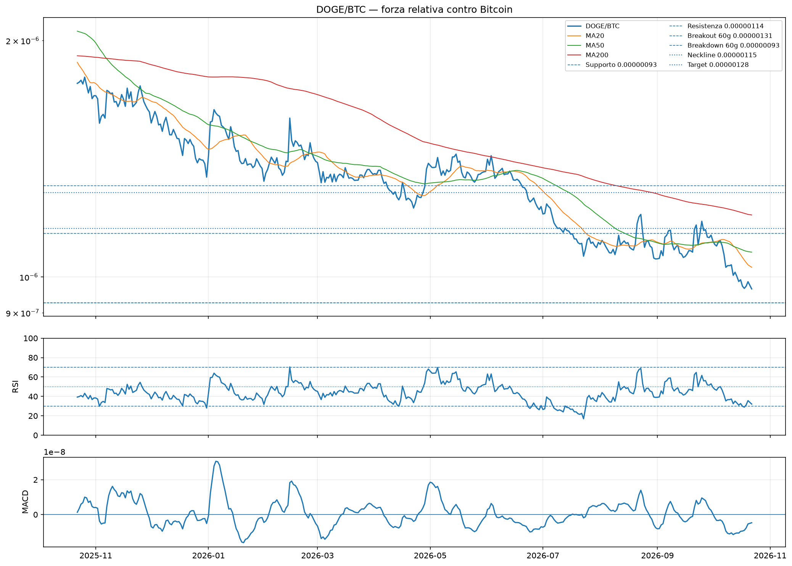

# Forza relativa SOL/BTC e DOGE/BTC

Generato: 2026-10-11 05:33 UTC

Questo modulo controlla se SOL e DOGE stanno davvero battendo Bitcoin. Una salita in USD accompagnata da una coppia ALT/BTC ribassista è spesso soltanto trascinamento di BTC.

**Protezione iniziale:** il candidato relativo è limitato a -1/0/+1, ma il peso nel Global resta **0**. La coppia BTC conferma o indebolisce il tecnico USD; non viene sommata come secondo modulo indipendente.

## Sintesi

| Asset | Coppia | Prezzo | Score raw | Candidato | Peso Global | Forza vs BTC | Confidenza | 30g | Tecnico USD | Lettura combinata |
| --- | --- | --- | --- | --- | --- | --- | --- | --- | --- | --- |
| SOL | SOL/BTC | 0.00131980 | +2 | 0 | 0 | RELATIVA MISTA / NON CONFERMATA | BASSA | +2,39% | MISTA | QUADRO MISTO / NESSUNA CONFERMA RELATIVA |
| DOGE | DOGE/BTC | 0.00000103 | -5 | -1 | 0 | SOTTOPERFORMA BTC | MEDIA | -5,05% | RIBASSISTA | DEBOLEZZA COMPLETA: scende in USD e contro BTC |

## Matrice di lettura

| ALT/USD | ALT/BTC | Interpretazione |
| --- | --- | --- |
| Rialzista | Rialzista | Conferma migliore: sale e batte BTC |
| Rialzista | Ribassista | Sale soprattutto perché BTC trascina il mercato |
| Ribassista | Rialzista | Forza relativa nascosta / possibile rotazione futura |
| Ribassista | Ribassista | Debolezza completa |

## SOL/BTC

- **Verdetto relativo:** RELATIVA MISTA / NON CONFERMATA (+2)
- **Candidato futuro:** 0; **peso attuale Global: 0**
- **Lettura combinata USD/BTC:** QUADRO MISTO / NESSUNA CONFERMA RELATIVA
- **Struttura:** MASSIMI E MINIMI CRESCENTI
- **Rendimenti relativi:** 7g -6,53%; 30g +2,39%; 90g +9,44%; 180g +13,38%
- **Daily:** RSI 38.70; MA50 0.00134114; MA200 0.00120066
- **Weekly:** MA30 0.00120583; RSI 53.63
- **Livelli:** supporto 0.00127800; resistenza 0.00133900; breakout 60g 0.00146600; breakdown 60g 0.00113000
- **Pattern:** DOPPIO MINIMO / TARGET RAGGIUNTO; neckline 0.00133900; target 0.00140150
- **Fibonacci:** NON ATTIVO — 38.2% a 0.00129143
- **Fonte:** Yahoo Finance SOL-BTC (coppia diretta)
- **Motivi score:** prezzo sotto MA50 daily; prezzo sopra MA200 daily; MA50 daily in salita; prezzo sopra MA30 weekly; MA30 weekly in salita; struttura con massimi/minimi crescenti; RSI relativo debole; MACD relativo negativo

## DOGE/BTC

- **Verdetto relativo:** SOTTOPERFORMA BTC (-5)
- **Candidato futuro:** -1; **peso attuale Global: 0**
- **Lettura combinata USD/BTC:** DEBOLEZZA COMPLETA: scende in USD e contro BTC
- **Struttura:** MASSIMI E MINIMI CRESCENTI
- **Rendimenti relativi:** 7g -6,11%; 30g -5,05%; 90g -9,80%; 180g -18,63%
- **Daily:** RSI 35.80; MA50 0.00000110; MA200 0.00000122
- **Weekly:** MA30 0.00000122; RSI 37.35
- **Livelli:** supporto 0.00000100; resistenza 0.00000114; breakout 60g 0.00000131; breakdown 60g 0.00000099
- **Pattern:** DOPPIO MINIMO / TARGET RAGGIUNTO; neckline 0.00000115; target 0.00000128
- **Fibonacci:** NON ATTIVO — 23.6% a 0.00000110
- **Fonte:** Rapporto sintetico DOGE-USD / BTC-USD (sintetica)
- **Motivi score:** prezzo sotto MA50 daily; prezzo sotto MA200 daily; prezzo sotto MA30 weekly; MA30 weekly in discesa; struttura con massimi/minimi crescenti; RSI relativo debole; MACD relativo negativo

## Backtest storico diagnostico

Il backtest usa soltanto indicatori disponibili alla data del segnale e campiona una volta a settimana. È utile subito, ma non sostituisce il tracker live: le soglie sono state definite prima di vedere il risultato.

| Asset | Orizzonte | Controlli | Accuratezza | Return corretto direzione | Return futuro mediano |
| --- | --- | --- | --- | --- | --- |
| SOL | 7g | 212 | 52,36% | +1,92% | -1,06% |
| SOL | 30g | 208 | 48,08% | +4,59% | +0,67% |
| SOL | 90g | 202 | 52,97% | +9,80% | +3,12% |
| DOGE | 7g | 296 | 55,41% | +1,80% | -1,66% |
| DOGE | 30g | 295 | 52,88% | +1,96% | -3,48% |
| DOGE | 90g | 290 | 54,48% | +6,90% | -8,85% |

## Tracker live e gate futuro

| Asset | Orizzonte | Controlli | Accuratezza | Return corretto | Stato | Peso Global |
| --- | --- | --- | --- | --- | --- | --- |
| SOL | 1g | 52 | 48,08% | -0,02% | LOCKED / RACCOLTA LIVE | 0 |
| SOL | 3g | 51 | 45,10% | +0,11% | LOCKED / RACCOLTA LIVE | 0 |
| SOL | 7g | 47 | 40,43% | +0,06% | LOCKED / RACCOLTA LIVE | 0 |
| SOL | 14g | 41 | 43,90% | +0,10% | LOCKED / RACCOLTA LIVE | 0 |
| SOL | 30g | 35 | 57,14% | -0,22% | LOCKED / RACCOLTA LIVE | 0 |
| DOGE | 1g | 60 | 66,67% | +0,09% | LOCKED / RACCOLTA LIVE | 0 |
| DOGE | 3g | 58 | 60,34% | +0,17% | LOCKED / RACCOLTA LIVE | 0 |
| DOGE | 7g | 56 | 55,36% | -0,31% | LOCKED / RACCOLTA LIVE | 0 |
| DOGE | 14g | 54 | 50,00% | -0,66% | LOCKED / RACCOLTA LIVE | 0 |
| DOGE | 30g | 48 | 52,08% | -0,47% | LOCKED / RACCOLTA LIVE | 0 |

Gate prudente: almeno 30 controlli live a 7 giorni, accuratezza almeno 55% e return corretto direzione positivo. Anche dopo il gate, il contributo futuro non dovrà superare ±1 e dovrà restare dentro la famiglia tecnica.

## File prodotti

- `reports/relative_strength_btc_metrics.csv`
- `reports/relative_strength_btc_history.csv`
- `reports/relative_strength_btc_tracker_metrics.csv`
- `reports/relative_strength_btc_backtest.csv`
