<!-- SCANNER_FORECAST_TRACKER_START -->
# Scanner forecast path / cono probabilistico

Generato: 2026-10-13 05:32:20 UTC

## Snapshot effettivamente usato

| Asset   | Snapshot prezzo   | Generazione snapshot prezzo   | Snapshot match scanner   |
|:--------|:------------------|:------------------------------|:-------------------------|
| BTC | 2026-10-13 | 2026-10-13T05:30:22Z | 2026-10-13 05:30:23 |
| SOL | 2026-10-13 | 2026-10-13T05:30:22Z | 2026-10-13 05:30:23 |
| DOGE | 2026-10-13 | 2026-10-13T05:30:22Z | 2026-10-13 05:30:23 |

La data di generazione del report non sostituisce la data degli input: se gli snapshot locali sono più vecchi, i valori restano riferiti agli snapshot indicati in tabella.

Questo report trasforma i 40 casi simili dello scanner in un cono previsionale leggibile.

Per ogni asset crea:

- banda larga p10-p90
- banda centrale p25-p75
- scenario centrale p50
- prezzo reale sovrapposto quando sono disponibili dati successivi

Correzione importante: il cono ora viene calcolato dai percorsi reali dei match storici, non solo dai percentili finali a 30 giorni. Quindi il grafico non deve più mostrare solo due puntini.

## Ultimo cono previsionale salvato

| Asset   | Data       | Prezzo iniziale   | Direzione scanner   | Casi positivi   | P10 30g     | P25 30g     | P50 30g     | P75 30g     | P90 30g      |
|:--------|:-----------|:------------------|:--------------------|:----------------|:------------|:------------|:------------|:------------|:-------------|
| BTC | 2026-10-13 | 83.631 $ | INCERTO | 55,00% | 66.377,09 $ | 73.378,12 $ | 85.015,50 $ | 93.088,23 $ | 108.515,77 $ |
| SOL | 2026-10-13 | 108,21 $ | SALITA | 70,00% | 84,92 $ | 102,66 $ | 114,63 $ | 125,85 $ | 140,47 $ |
| DOGE | 2026-10-13 | 0.08469 $ | SALITA | 80,00% | 0.07102 $ | 0.08678 $ | 0.09577 $ | 0.10266 $ | 0.11446 $ |

## Confronto raw / regime-adjusted

Il cono raw continua a usare i 40 casi dello scanner. Il cono regime-adjusted sceglie una sola coorte nella gerarchia SAME_BTC_AND_ASSET_REGIME → SAME_ASSET_REGIME → SAME_BTC_REGIME. Ogni livello richiede almeno 5 match; le coorti non vengono mai combinate e ogni fallback è dichiarato.

| Asset   | Stato adjusted   | selected_regime_group   |   full_regime_matches |   same_asset_regime_matches |   same_btc_regime_matches |   selected_sample_size |   minimum_required | fallback_level        | selection_reason              | Raw p50 30g   | Adjusted p50 30g   | Raw p90 30g   | Adjusted p90 30g   |
|:--------|:-----------------|:------------------------|----------------------:|----------------------------:|--------------------------:|-----------------------:|-------------------:|:----------------------|:------------------------------|:--------------|:-------------------|:--------------|:-------------------|
| BTC | AVAILABLE | SAME_BTC_REGIME | 1 | 3 | 5 | 5 | 5 | 2_SAME_BTC_FALLBACK | FALLBACK_TO_SAME_BTC_REGIME | 85.015,50 $ | 88.276,27 $ | 108.515,77 $ | 107.892,82 $ |
| SOL | AVAILABLE | SAME_ASSET_REGIME | 3 | 5 | 15 | 5 | 5 | 1_SAME_ASSET_FALLBACK | FALLBACK_TO_SAME_ASSET_REGIME | 114,63 $ | 109,75 $ | 140,47 $ | 129,36 $ |
| DOGE | AVAILABLE | SAME_BTC_REGIME | 1 | 3 | 6 | 6 | 5 | 2_SAME_BTC_FALLBACK | FALLBACK_TO_SAME_BTC_REGIME | 0.09577 $ | 0.08836 $ | 0.11446 $ | 0.12786 $ |

## Grafici

### BTC

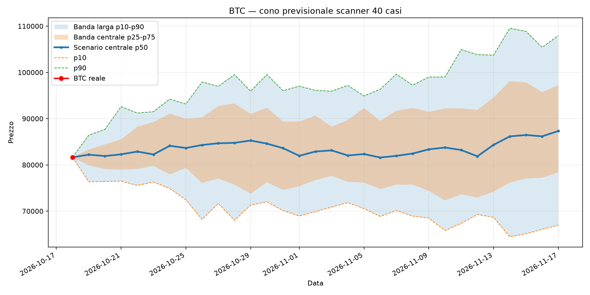

#### Verifica storica e discrepanza

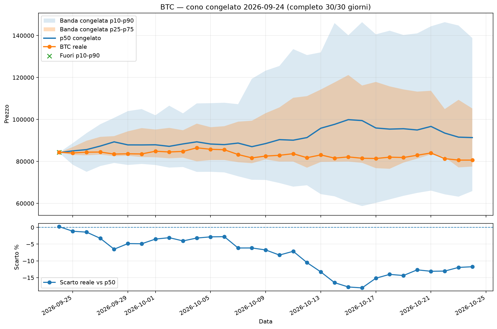

- Cono congelato il **2026-09-13**; verificato fino al **2026-10-13**; stato **COMPLETO 30/30g**.
- Reale **83.589,23 $**; p50 previsto **105.839,20 $**; scarto **-21,02%**.
- Errore medio assoluto **5,52%**; massimo **21,02%**; DENTRO p10-p90; FUORI p25-p75.

#### Cono regime-adjusted

Gruppo selezionato: **SAME_BTC_REGIME**; fallback: **2_SAME_BTC_FALLBACK**; motivo: **FALLBACK_TO_SAME_BTC_REGIME**.

**WARNING:** coorte fallback meno stringente rispetto a SAME_BTC_AND_ASSET_REGIME.

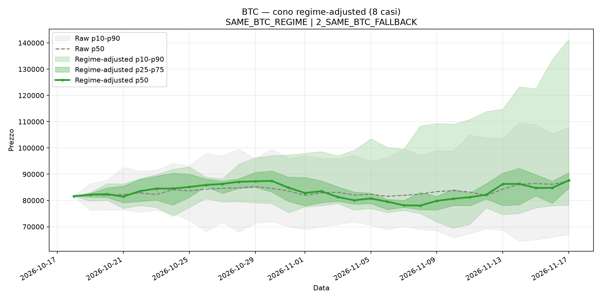

### SOL

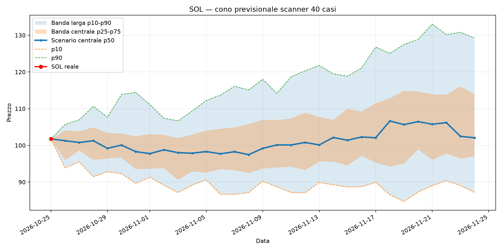

<!-- SOL_CONDITIONAL_ANALYSES_START -->
#### SOL — Analisi condizionata -5% → +10%

Queste analisi sono **separate dal cono SOL originale**. Il cono sopra continua a usare normalmente i **40 analoghi più simili a SOL**.

Il filtro condizionato parte proprio da quei 40 casi e conserva soltanto gli episodi che hanno toccato **prima -5%** dal proprio baseline e **successivamente +10% entro 30 giorni**.

##### A. Conditional Successor corrente — dinamico

Questo campione viene ricostruito ad ogni run dai **40 analoghi SOL correnti**. Di conseguenza il numero di episodi qualificati e gli asset possono cambiare giorno per giorno.

**Campione corrente:** 12 episodi qualificati su 40 · 10 asset distinti.

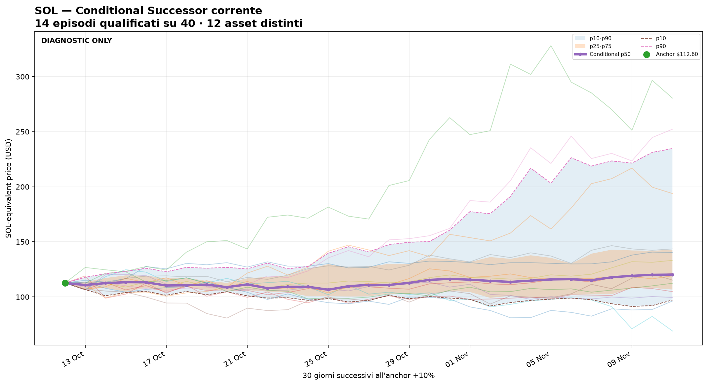

###### Confronto diretto a 30 giorni

| Modello | Vintage | N | Target | P10 | P25 | P50 | P75 | P90 |
| --- | --- | ---: | --- | ---: | ---: | ---: | ---: | ---: |
| Cono standard | 2026-10-13 | 40 | 2026-11-12 | 84.92 $ | 102.66 $ | 114.63 $ | 125.85 $ | 140.47 $ |
| Conditional corrente | 2026-10-13 | 12 | 2026-11-12 | 92.80 $ | 99.45 $ | 115.59 $ | 150.06 $ | 236.80 $ |

###### Struttura successiva dei casi correnti

| Classe | Episodi | Frequenza empirica |
| --- | ---: | ---: |
| DIRECT_CONTINUATION | 4 | 33.33% |
| SHALLOW_PULLBACK_THEN_CONTINUATION | 3 | 25.00% |
| DEEP_PULLBACK_THEN_RECOVERY | 1 | 8.33% |
| FAILURE | 4 | 33.33% |
| UNRESOLVED | 0 | 0.00% |

###### Episodi qualificati oggi

| Asset | Match window | -5% hit | +10% anchor | Classe 60d |
| --- | --- | --- | --- | --- |
| HBAR-USD | 2022-11-29 → 2023-03-08 | 2023-03-09 | 2023-03-29 | FAILURE |
| AVAX-USD | 2021-07-01 → 2021-10-08 | 2021-10-10 | 2021-10-25 | DEEP_PULLBACK_THEN_RECOVERY |
| XTZ-USD | 2019-09-24 → 2020-01-01 | 2020-01-02 | 2020-01-20 | SHALLOW_PULLBACK_THEN_CONTINUATION |
| VET-USD | 2022-11-29 → 2023-03-08 | 2023-03-09 | 2023-03-17 | FAILURE |
| ETH-USD | 2021-06-15 → 2021-09-22 | 2021-09-28 | 2021-10-02 | DIRECT_CONTINUATION |
| ZIL-USD | 2022-11-29 → 2023-03-08 | 2023-03-09 | 2023-03-14 | SHALLOW_PULLBACK_THEN_CONTINUATION |
| SNX-USD | 2020-11-17 → 2021-02-24 | 2021-02-26 | 2021-03-02 | FAILURE |
| ETC-USD | 2023-09-18 → 2023-12-26 | 2024-01-07 | 2024-01-10 | DIRECT_CONTINUATION |
| VET-USD | 2020-04-18 → 2020-07-26 | 2020-07-27 | 2020-08-06 | SHALLOW_PULLBACK_THEN_CONTINUATION |
| RUNE-USD | 2023-07-01 → 2023-10-08 | 2023-10-09 | 2023-10-23 | DIRECT_CONTINUATION |
| FIL-USD | 2022-12-01 → 2023-03-10 | 2023-03-11 | 2023-03-13 | FAILURE |
| ETH-USD | 2022-11-27 → 2023-03-06 | 2023-03-09 | 2023-03-17 | DIRECT_CONTINUATION |

##### B. Vintage originale 18 settembre — congelato

Questo invece **non cambia più**. Conserva gli 8 episodi / 6 asset della nostra analisi originale e serve per verificare fuori campione se quella specifica previsione descrive bene SOL.

Anchor della chat: circa **$112.70** il **2026-09-18**.

**SMALL SAMPLE · SENSITIVITY UNSTABLE · DIAGNOSTIC ONLY.**

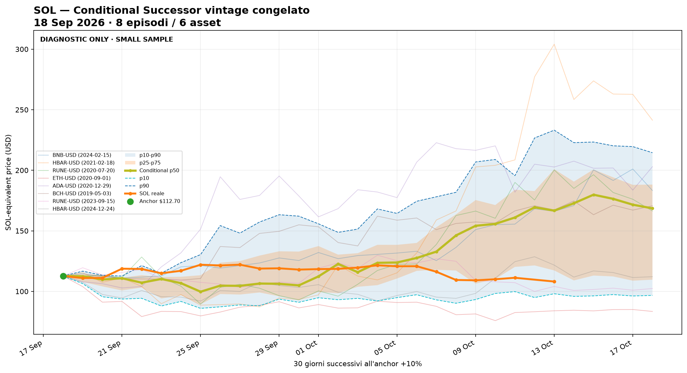

###### Percentili congelati a 30 giorni

| Modello | Vintage | N | Target | P10 | P25 | P50 | P75 | P90 |
| --- | --- | ---: | --- | ---: | ---: | ---: | ---: | ---: |
| Conditional vintage | 2026-09-18 | 8 | 2026-10-18 | 96.70 $ | 109.70 $ | 168.54 $ | 188.19 $ | 214.50 $ |

###### Verifica contro SOL reale

- Ultimo close disponibile: **2026-10-13** · SOL **108.14 $**.
- Giorno del vintage: **25/30**.
- P50 condizionato previsto per quel giorno: **166.69 $**.
- SOL reale: **DENTRO p10-p90** · **FUORI p25-p75**.

###### Parità con l'analisi originale

| Giorno | Mediana return riprodotta |
| ---: | ---: |
| 7 | -11.51% |
| 14 | 8.85% |
| 21 | 36.80% |
| 30 | 49.55% |

###### Gli 8 episodi congelati

| Asset | Match window | -5% hit | +10% anchor |
| --- | --- | --- | --- |
| BNB-USD | 2023-10-13 → 2024-01-20 | 2024-01-23 | 2024-02-15 |
| HBAR-USD | 2020-11-04 → 2021-02-11 | 2021-02-14 | 2021-02-18 |
| RUNE-USD | 2020-03-28 → 2020-07-05 | 2020-07-06 | 2020-07-20 |
| ETH-USD | 2020-05-11 → 2020-08-18 | 2020-08-21 | 2020-09-01 |
| ADA-USD | 2020-09-08 → 2020-12-16 | 2020-12-21 | 2020-12-29 |
| BCH-USD | 2019-01-17 → 2019-04-26 | 2019-04-29 | 2019-05-03 |
| RUNE-USD | 2023-06-01 → 2023-09-08 | 2023-09-11 | 2023-09-15 |
| HBAR-USD | 2024-09-04 → 2024-12-12 | 2024-12-18 | 2024-12-24 |

**Come leggere la differenza:** il cono standard risponde a "cosa hanno fatto i 40 casi più simili?". Il Conditional Successor risponde a una domanda più stretta: "tra quei casi, cosa è successo dopo che avevano già completato -5% → +10%?". Per questo il secondo può risultare più rialzista ma anche molto più fragile statisticamente.

I due modelli **non vengono mediati**, non sostituiscono l'uno l'altro e non modificano Global Confluence, segnali o decisioni.

<!-- SOL_CONDITIONAL_ANALYSES_END -->

#### Verifica storica e discrepanza

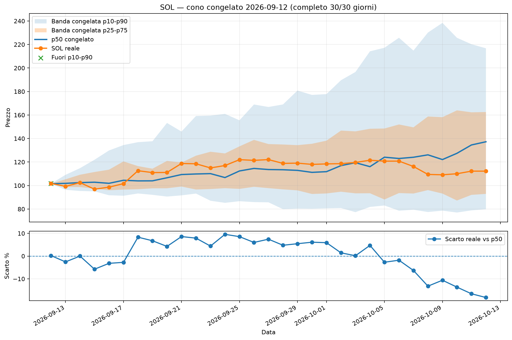

- Cono congelato il **2026-09-13**; verificato fino al **2026-10-13**; stato **COMPLETO 30/30g**.
- Reale **108,14 $**; p50 previsto **135,67 $**; scarto **-20,29%**.
- Errore medio assoluto **6,55%**; massimo **20,29%**; DENTRO p10-p90; DENTRO p25-p75.

#### Cono regime-adjusted

Gruppo selezionato: **SAME_ASSET_REGIME**; fallback: **1_SAME_ASSET_FALLBACK**; motivo: **FALLBACK_TO_SAME_ASSET_REGIME**.

**WARNING:** coorte fallback meno stringente rispetto a SAME_BTC_AND_ASSET_REGIME.

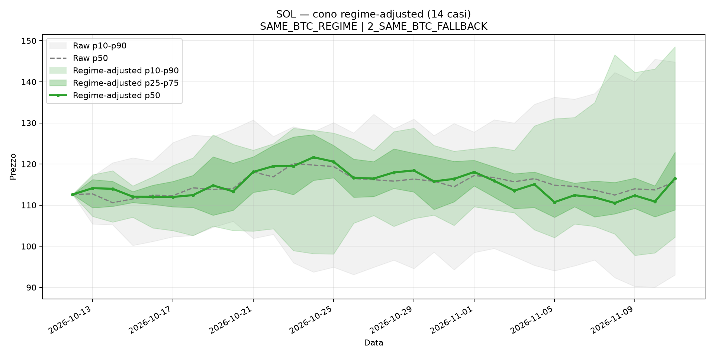

### DOGE

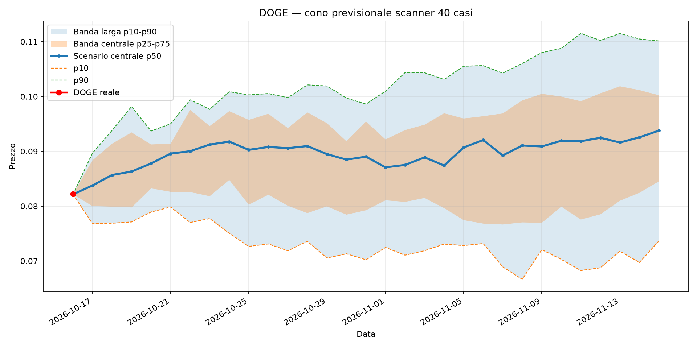

#### Verifica storica e discrepanza

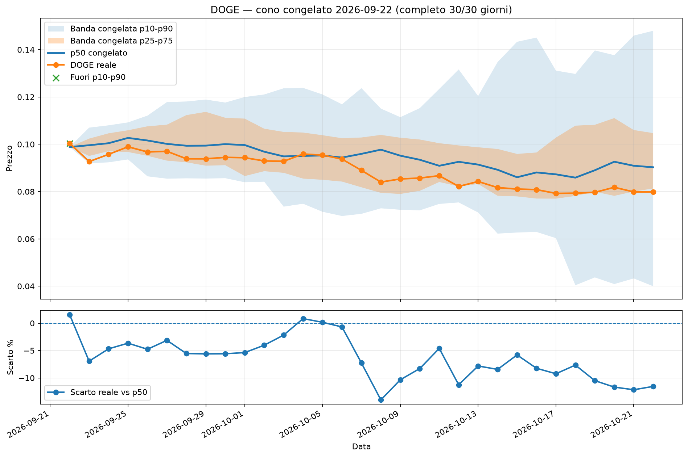

- Cono congelato il **2026-09-13**; verificato fino al **2026-10-13**; stato **COMPLETO 30/30g**.
- Reale **0.08464 $**; p50 previsto **0.07220 $**; scarto **17,23%**.
- Errore medio assoluto **14,24%**; massimo **23,24%**; DENTRO p10-p90; FUORI p25-p75.

#### Cono regime-adjusted

Gruppo selezionato: **SAME_BTC_REGIME**; fallback: **2_SAME_BTC_FALLBACK**; motivo: **FALLBACK_TO_SAME_BTC_REGIME**.

**WARNING:** coorte fallback meno stringente rispetto a SAME_BTC_AND_ASSET_REGIME.

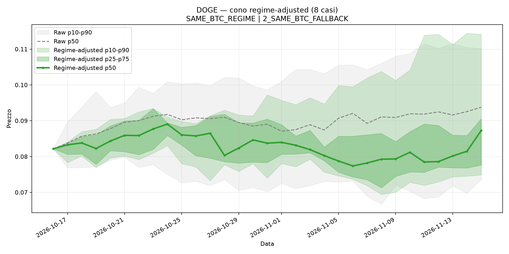

## Accuratezza percorso scanner

| Asset   | Giorno   |   Controlli | Dentro p10-p90   | Dentro p25-p75   | Errore medio abs vs p50   | Errore medio vs p50   |
|:--------|:---------|------------:|:-----------------|:-----------------|:--------------------------|:----------------------|
| BTC | 1g | 87 | 94,25% | 71,26% | 1,83% | 0,38% |
| BTC | 3g | 83 | 93,98% | 78,31% | 3,12% | 0,62% |
| BTC | 7g | 75 | 93,33% | 70,67% | 4,85% | 1,34% |
| BTC | 14g | 62 | 98,39% | 75,81% | 5,61% | 1,09% |
| BTC | 30g | 36 | 100,00% | 75,00% | 11,00% | -2,82% |
| SOL | 1g | 87 | 85,06% | 63,22% | 2,63% | 0,62% |
| SOL | 3g | 83 | 91,57% | 72,29% | 3,79% | 1,51% |
| SOL | 7g | 75 | 92,00% | 76,00% | 5,68% | 2,77% |
| SOL | 14g | 62 | 88,71% | 79,03% | 7,95% | 5,34% |
| SOL | 30g | 36 | 94,44% | 66,67% | 14,26% | 7,10% |
| DOGE | 1g | 87 | 88,51% | 60,92% | 2,97% | 0,35% |
| DOGE | 3g | 83 | 92,77% | 63,86% | 4,51% | 1,22% |
| DOGE | 7g | 75 | 77,33% | 74,67% | 8,39% | 4,70% |
| DOGE | 14g | 62 | 85,48% | 53,23% | 10,17% | 8,40% |
| DOGE | 30g | 36 | 94,44% | 38,89% | 16,90% | 16,90% |

## Tail / outlier audit

I casi di coda restano nel calcolo. L'audit leave-one-out quantifica la sensibilità dei percentili senza trasformare l'analisi in un filtro discrezionale.

Dettaglio completo: [scanner_forecast_tail_outlier_audit.md](scanner_forecast_tail_outlier_audit.md).

## Calibratore shadow

Il cono ufficiale resta grezzo e invariato. Il calibratore usa soltanto previsioni passate già mature, campionate una volta a settimana per ridurre la falsa indipendenza. Ogni orizzonte si attiva a 30 controlli indipendenti: parte al 25% della correzione stimata e cresce gradualmente fino al 100% a 100 controlli.

| Asset   | Orizzonte   |   Controlli indipendenti |   Soglia | Stato                  | Forza correzione   | Shift p50   |   Scala p10-p90 |
|:--------|:------------|-------------------------:|---------:|:-----------------------|:-------------------|:------------|----------------:|
| BTC | 1g | 15 | 30 | RACCOLTA (15 mancanti) | 0,0% | 0,00% | 1,000 |
| BTC | 3g | 14 | 30 | RACCOLTA (16 mancanti) | 0,0% | 0,00% | 1,000 |
| BTC | 7g | 14 | 30 | RACCOLTA (16 mancanti) | 0,0% | 0,00% | 1,000 |
| BTC | 14g | 13 | 30 | RACCOLTA (17 mancanti) | 0,0% | 0,00% | 1,000 |
| BTC | 30g | 10 | 30 | RACCOLTA (20 mancanti) | 0,0% | 0,00% | 1,000 |
| SOL | 1g | 15 | 30 | RACCOLTA (15 mancanti) | 0,0% | 0,00% | 1,000 |
| SOL | 3g | 14 | 30 | RACCOLTA (16 mancanti) | 0,0% | 0,00% | 1,000 |
| SOL | 7g | 14 | 30 | RACCOLTA (16 mancanti) | 0,0% | 0,00% | 1,000 |
| SOL | 14g | 13 | 30 | RACCOLTA (17 mancanti) | 0,0% | 0,00% | 1,000 |
| SOL | 30g | 10 | 30 | RACCOLTA (20 mancanti) | 0,0% | 0,00% | 1,000 |
| DOGE | 1g | 15 | 30 | RACCOLTA (15 mancanti) | 0,0% | 0,00% | 1,000 |
| DOGE | 3g | 14 | 30 | RACCOLTA (16 mancanti) | 0,0% | 0,00% | 1,000 |
| DOGE | 7g | 14 | 30 | RACCOLTA (16 mancanti) | 0,0% | 0,00% | 1,000 |
| DOGE | 14g | 13 | 30 | RACCOLTA (17 mancanti) | 0,0% | 0,00% | 1,000 |
| DOGE | 30g | 10 | 30 | RACCOLTA (20 mancanti) | 0,0% | 0,00% | 1,000 |

### Confronto fuori campione: grezzo vs shadow

| Asset   | Orizzonte   |   Controlli OOS | MAE grezzo   | MAE shadow   | Miglioramento   | Shadow vince   | Copertura larga grezza   | Copertura larga shadow   |
|:--------|:------------|----------------:|:-------------|:-------------|:----------------|:---------------|:-------------------------|:-------------------------|
| BTC | 1g | 0 | n/a | n/a | n/a | n/a | n/a | n/a |
| BTC | 3g | 0 | n/a | n/a | n/a | n/a | n/a | n/a |
| BTC | 7g | 0 | n/a | n/a | n/a | n/a | n/a | n/a |
| BTC | 14g | 0 | n/a | n/a | n/a | n/a | n/a | n/a |
| BTC | 30g | 0 | n/a | n/a | n/a | n/a | n/a | n/a |
| DOGE | 1g | 0 | n/a | n/a | n/a | n/a | n/a | n/a |
| DOGE | 3g | 0 | n/a | n/a | n/a | n/a | n/a | n/a |
| DOGE | 7g | 0 | n/a | n/a | n/a | n/a | n/a | n/a |
| DOGE | 14g | 0 | n/a | n/a | n/a | n/a | n/a | n/a |
| DOGE | 30g | 0 | n/a | n/a | n/a | n/a | n/a | n/a |
| SOL | 1g | 0 | n/a | n/a | n/a | n/a | n/a | n/a |
| SOL | 3g | 0 | n/a | n/a | n/a | n/a | n/a | n/a |
| SOL | 7g | 0 | n/a | n/a | n/a | n/a | n/a | n/a |
| SOL | 14g | 0 | n/a | n/a | n/a | n/a | n/a | n/a |
| SOL | 30g | 0 | n/a | n/a | n/a | n/a | n/a | n/a |

## Come leggerlo

- Se il prezzo resta dentro p10-p90, lo scanner sta ancora descrivendo bene il range largo.
- Se il prezzo resta dentro p25-p75, lo scanner sta descrivendo bene anche il range centrale.
- Se il prezzo segue p50, il percorso reale è vicino allo scenario normale.
- Se il prezzo esce da p10-p90, il modello statistico dei 40 casi sta perdendo aderenza.
- Questo non sostituisce drawdown e max gain: serve soprattutto a vedere il percorso del return previsto.

Nota: servono almeno 5 controlli prima di dare un peso minimo al cono. Sotto 5 controlli resta solo osservazione.
<!-- SCANNER_FORECAST_TRACKER_END -->